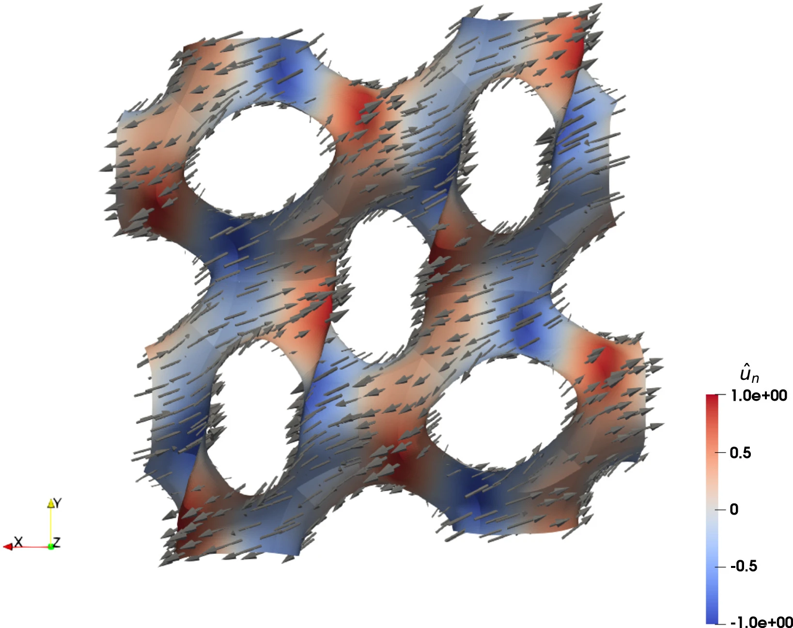
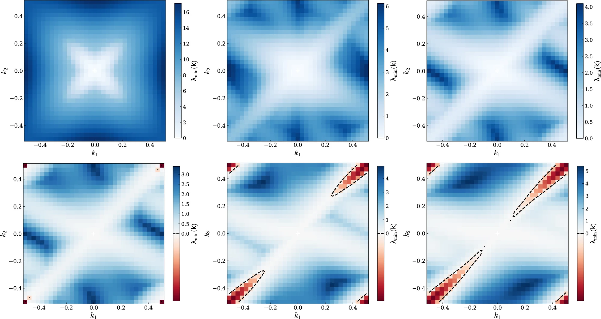

**Abstract**
Periodic architected materials achieve outstanding properties beyond those of conventional solids, enabling a broad range of applications. For thin-shell architected structures in particular, the critical design limit at the onset of failure is often not material strength but structural stability. Understanding how and when instability occurs demands more than classical buckling analysis. These structures can lose stability at finite wavelengths that conventional long-wavelength analyses overlook, while the instability itself depends strongly on the loading path. To address these challenges, we present a computational framework for the homogenization and stability analysis of periodic architected materials, demonstrated on triply periodic minimal surface (TPMS) structures. The framework combines a Cauchy–Born-based homogenization of an isogeometric Kirchhoff–Love (KL) shell unit cell with a residual–penalty formulation. The formulation enables flexible loading control, including strain, stress, and mixed control. Stability is assessed through the loss of rank-one convexity and a Bloch wave analysis over the first Brillouin zone. Applied to the Schwarz-P cell, the framework reveals that the instability character depends sensitively on the loading control strategy, the shell thickness, and the shear component. Notably, combined shear and compression triggers a short-wavelength bifurcation in thin shells that neither compression nor shear alone can induce. The framework provides a basis for stability-informed design of periodic architected materials.

**Keywords:** Architected materials; Triply periodic minimal surfaces (TPMS); Isogeometric analysis (IGA); Kirchhoff–Love (KL) shell; Mixed control; Computational homogenization; Bloch wave stability analysis

Open access under a [CC BY 4.0](http://creativecommons.org/licenses/by/4.0/) license.

[Download paper here](https://www.sciencedirect.com/science/article/pii/S0020768326006104)
